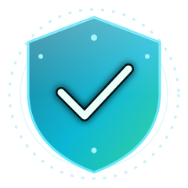

<div align="center">



# ShieldGuard 🛡️

**Ransomware & data-theft early warning for everyone — not just for sysadmins.**

[](https://github.com/HuzaifaAbbasi6901/shieldguard/actions/workflows/ci.yml)
[](LICENSE)
[](https://shieldguard-bay.vercel.app)
[](CONTRIBUTING.md)

**A local agent watches your folders, processes, and network for ransomware-like
behavior and data theft — and warns you in plain language, with one-click protective
actions. 100% local. No telemetry. No jargon.**

[Live demo (Demo Mode)](https://shieldguard-bay.vercel.app) · [Quick start](#-quick-start) · [How detection works](docs/detection-logic.md) · [Screenshots](docs/screenshots)

</div>

---

## ⚠️ Read this first (honest disclaimer)

ShieldGuard is an **early-warning system, not antivirus, not EDR, and not a backup
solution**. It detects *behavior* after it starts, which means:

- very fast ransomware may encrypt some files before ShieldGuard (or any detector) reacts;
- slow, careful attacks can stay under thresholds;
- harmless programs (backups, sync clients, video editors) sometimes trigger alerts —
  you can allowlist them in one click.

**The only reliable protection is backups (3-2-1) plus updates.** ShieldGuard exists to
shrink the gap between "something bad started" and "you noticed", and to tell you, in
plain words, what to do next.

## ✨ What you get

- 🔎 **Real-time watch** over folders you choose: file-change bursts, files turning into
  scrambled data (entropy), files renamed to `.locked`-style endings, ransom notes,
  magic-byte mismatches, hidden canary trip-wire files.
- 📤 **Data-theft watch**: upload spikes, programs opening many internet connections,
  "reading many files then sending" patterns, big archives appearing in temp folders,
  USB bulk copies, new startup/persistence entries, unexpected remote-control tools.
- 🧠 **Plain-language alerts** with a 0–100 threat score and a "why" list — no jargon
  unless you open *Advanced details*.
- 🚨 **Panic Button**: suspend the suspect process, snapshot-backup your folders
  (optional AES-256-GCM), optionally cut network access — each with one-click undo and
  a guided checklist ("Do not restart", "Unplug backup drives", "Change passwords from
  a different device"…).
- 🧪 **Safe Simulator**: one click shows you exactly what a real alert looks like —
  100% harmless, runs in an isolated sandbox folder.
- 📊 **Dashboard**: animated radar hero, live graphs (file changes/s, upload KiB/s,
  threat score), network view, incident timeline, backups & quarantine manager,
  weekly report (PDF export), health score, onboarding wizard, optional PIN lock.
- 🌐 **Two modes**: **Demo Mode** (default on the public Vercel site — realistic
  simulated data generated in your browser) and **Live Mode** (talks to the local agent
  on your machine via REST + WebSocket, with auto-detect).

## 🚀 Quick start

**Try it in 10 seconds (nothing to install):** open the live demo →
[shieldguard-bay.vercel.app](https://shieldguard-bay.vercel.app) → press
*Safe Simulator → Simulate ransomware behavior* and watch the system react.

**Protect your real folders (5 minutes):**

```bash
# 1. get the code
git clone https://github.com/HuzaifaAbbasi6901/shieldguard.git
cd shieldguard

# 2. start everything (installs dependencies on first run)
python run.py
```

That's it: the agent runs on `http://127.0.0.1:8787`, the dashboard opens on
`http://localhost:3000` in **Live Mode**. Pick your folders in the onboarding wizard.

> Requirements: Python 3.10+ and Node.js 18.17+. Detailed steps, Docker, macOS/Linux
> variants: **[docs/DEPLOYMENT.md](docs/DEPLOYMENT.md)**.

## 🧱 How it fits together

```
folders you chose ──► LOCAL AGENT (Python, 127.0.0.1:8787)
                       ├─ watchdog: file events ─┐
                       ├─ psutil: network/proc ──┤→ detectors → 0-100 score
                       ├─ canary trip-wires ─────┘        ↓
                       └─ SQLite (local) ◄──── events in plain language
                                   │ REST + WebSocket
                       DASHBOARD (Next.js 14) — localhost:3000 or Vercel demo
```

Only the dashboard is deployed to Vercel (Demo Mode). **The agent cannot run on
serverless** — it must run on the computer it protects. That's a feature: your files
never leave your machine.

| Repo folder | What's inside |
|---|---|
| [`agent/`](agent) | Python 3.10+ · FastAPI · watchdog · psutil · SQLite · cryptography — detectors with unit tests |
| [`web/`](web) | Next.js 14 App Router · TypeScript · Tailwind · shadcn-style UI · Recharts · Framer Motion — demo-data engine included |
| [`docs/`](docs) | [architecture](docs/architecture.md) · [detection logic](docs/detection-logic.md) · [threat model](docs/threat-model.md) · [deployment guide](docs/DEPLOYMENT.md) |
| [`CONTRACT.md`](CONTRACT.md) | The binding API contract shared by agent + dashboard |

## 🛡️ Safety & privacy by design

- **Purely defensive.** No malware, no exploits, no evasion — ever. Testing uses only
  the labelled Safe Simulator inside its sandbox folder.
- **Local only.** The agent binds to `127.0.0.1`, keeps everything in a local SQLite
  DB, and has no telemetry. The only optional outbound calls are notification webhooks
  you configure (Discord/Telegram).
- **Minimal file access.** It reads at most the first 64 KiB (entropy sample) and
  16 bytes (magic check) of changed files — never full contents.
- **You stay in control.** Only folders you pick are watched. Destructive actions need
  confirmation; suspension is reversible; backups restore into a *new* folder; nothing
  is ever auto-deleted. See the full [threat model](docs/threat-model.md).

## ✅ Verification checklist (what CI + this repo guarantee)

- [x] `pytest` — entropy, rate windows, scoring, canary, exfil heuristics, backups (incl.
      AES-GCM roundtrip), quarantine, REST API
- [x] `npm run lint` + `npm run build` — dashboard builds clean
- [x] No secrets committed (`.env` files are examples only; runtime data is git-ignored)
- [ ] *You, after deploying:* run the Safe Simulator and watch every alert type fire

## 🗺️ Roadmap / ideas welcome

- Signed releases + auto-update channel for the agent
- Windows tray app packaging (pystray) and macOS notarized app
- Optional GeoIP enrichment for the network view (offline DB, still no phone-home)
- More languages on top of the i18n-ready string structure (English first)
- Filter drivers / OS APIs (ETW, Endpoint Security framework) for stronger signals

## 🤝 Contributing

PRs are welcome — please read [CONTRIBUTING.md](CONTRIBUTING.md) (ground rule #1:
defensive features only). Found a security issue? [SECURITY.md](SECURITY.md).

## 📜 License

[MIT](LICENSE) © 2026 ShieldGuard contributors
